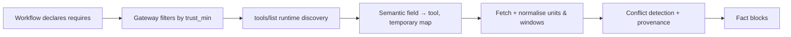

<div align="center">

# FAMAS

**Fund Analysis & Monitoring Agent System**


**One core · 24 composable workflows · Sign in to your data source once, then let it run**

**[简体中文](README.md)** · [English](README.en.md)

</div>

---

FAMAS is an **agent skill for fund analysis and monitoring**. It replaces a pile of prompts with a single core, declarative workflows, persona-free capability units, and a compliance gate that actually executes. It does not forecast returns. It does three things instead: **get the numbers right, state the assumptions plainly, and keep conclusions inside what the evidence allows**.

> This is not an investment-advice tool. Ratings, suitability and risk descriptions are bounded to structured information with traceable provenance.

---

## Why v2.0

v1 duplicated the same logic five times: nine skill entry points (4 Claude Code + 4 Codex + 1 TRAE), ten persona-driven agents, and four workflows redefined across five locations — roughly 1,600+ lines describing the same thing. Field definitions drifted, roles overlapped, and users had to memorise what each command did.

v2.0 collapses that into **one source of truth**:

| | v1 | v2.0 |
|---|---|---|
| Entry points | 9 skills + 10 agent personas | **1 core** + three ~20-line platform adapters |
| Workflows | 4, copied into 5 places | **24 declarative YAMLs** with `include`, overrides and ad-hoc composition |
| Field contract | Fees, rating cards and compliance defined separately | **One** `contracts/famas.contract.json` |
| Data | Model memory and manual input | **MCP data layer**: 38 semantic fields → runtime `tools/list` discovery |
| Compliance | Scattered across 4 docs (one section was deleted during a README redesign) | Defined once in `policies/compliance.md`, **enforced before output** |
| Conclusions | Star ratings, directly | Counter-evidence engine + four-part judgement + veto rules + confidence cap |

About 1,600 duplicated lines become roughly 60. Users only need to remember one word: `famas`.

---

## Architecture

```mermaid
flowchart LR
    U["Natural language"] --> C["Core · intent routing"]
    C --> W["Declarative workflow YAML"]
    W --> R["Capability registry"]
    R --> G["DataGateway"]
    G --> M[("Authorised finance MCP")]
    M --> F["Fact blocks + provenance"]
    F --> D["Devil's advocate"]
    D --> S["Four-part synthesis"]
    S --> P["Compliance / output gate"]
    P --> O["Sourced report"]

    style C fill:#1c3d5e,color:#fff
    style P fill:#b45309,color:#fff
    style M fill:#2f6da8,color:#fff
```



**Layering rule**: the fact layer emits facts only (nine persona-free capabilities plus periodic-report reading), the judgement layer emits counter-evidence only, and the synthesis layer is the **only** place allowed to hold a view. Monitoring is no longer an agent — it is a threshold rule set in `triggers/rules.yaml` plus the host scheduler.

---

## Quick start

### 1. Install

Put this repository in your workspace. Three thin platform adapters are ready; the logic lives in exactly one place:

```
.trae/skills/famas/SKILL.md     .claude/skills/famas/SKILL.md     .agents/skills/famas/SKILL.md
```

### 2. Sign in to a data source (once)

> **You sign in to the data provider's MCP — not to FAMAS.** FAMAS is plain text: no account, no login page, no stored credentials. OAuth 2.1 + PKCE or API Key authorisation happens in the host client.

Connect any supported finance data source in your host client, then say **"check the data sources"** for a first-run probe. Full guide: [SETUP.md](SETUP.md); config template: [mcp.json](mcp.json).

- **One** MCP is enough. Uncovered fields are listed explicitly under `missing_fields` — **no fabricated numbers**
- More sources enable cross-validation and trust grading. With none connected, FAMAS still outputs the analysis framework plus a list of fields to fill
- When a token expires or quota runs out, the host prompts again — that is the provider's concern, not a skill failure

### 3. Just talk to it

```
Analyse 005827                  →  core/a_single_fund
Read this quarterly report      →  events/periodic_report_deep_read
Which of these two funds fits   →  lifecycle/fund_replacement
Re-assess that earlier alert    →  events/alert_reassessment (auto-includes single-fund deep dive)
Check the data sources          →  data-quality/cross_source_verify (light probe)
```

Full intent map: [core/router.md](core/router.md).

---

## Core design

| Design | What it does | Where |
|---|---|---|
| **Single core** | `description` only triggers and routes; platform adapters carry no flow logic | [core/SKILL.md](core/SKILL.md) |
| **Declarative workflows** | Sequential / parallel / conditional / `include` / degradation / ad-hoc assembly, no new files | [workflows/\_schema.md](workflows/_schema.md) · [core/orchestrator.md](core/orchestrator.md) |
| **Single contract** | One JSON defines the fields; templates only render, compliance is defined once | [contracts/famas.contract.json](contracts/famas.contract.json) |
| **Semantic field layer** | Core knows neither vendors nor tool names; 38 semantic fields → runtime discovery | [data/gateway.md](data/gateway.md) · [data/semantic-fields.yaml](data/semantic-fields.yaml) |
| **Trust grading** | L1 primary disclosure > L2 licensed vendor > L3 secondary > L4 forbidden; conflicts are listed, never silently resolved | [policies/source-trust.md](policies/source-trust.md) |
| **Compliance gate** | Forbidden-term scan, risk notice up front, fixed disclaimer, per-field provenance | [policies/compliance.md](policies/compliance.md) |
| **Judgement layer** | Six counter-evidence modes → veto → four-part conclusion → confidence cap | [judgment/README.md](judgment/README.md) |

### How the data layer connects



The mapping **lives only in the session** and is never written back to the repo. Switching providers means adding one `data/providers/<id>.yaml` — **no workflow, capability, template or compliance change**. A verified provider declaration: [data/providers/wind-alice.yaml](data/providers/wind-alice.yaml).

---

## 24 workflows

| Category | Count | Representative scenarios |
|---|---:|---|
| `core` | 4 | Single-fund deep dive, universe screening, portfolio diagnosis, monitoring |
| `lifecycle` | 4 | Suitability check, **fund replacement**, goal back-solving, periodic review |
| `events` | 4 | Quarterly holdings shift, **periodic report deep read**, alert → re-assessment loop, corporate actions / manager changes |
| `research` | 4 | A/C share-class & ETF feeder cost breakeven, pseudo-diversification look-through, skill vs luck, sponsor concentration |
| `data-quality` | 2 | Cross-source verification, conclusion provenance audit |
| `judgment` | 3 | Thesis stress test, quarterly calibration, institutional evidence check |

Three further research workflows cover **manager narrative drift**, **prospectus clause consistency** and **cross-period report comparison**. The alert → re-assessment loop closes the v1 gap where alerts were raised but never revisited.

---

## Where the rigour comes from

Not from stuffing sell-side research into the prompt. A skill is prompting, not weights: corpora consume context, go stale immediately, and smuggle in conclusion-first reasoning and optimism bias. Rigour is engineered as four layers:

1. **Four-part judgement**: hypothesis → evidence → counter-evidence → invalidation conditions. Missing part 3 or 4 makes the output invalid and sends it back.
2. **Devil's advocate**: six modes (calibre / attribution / time / structure / alternative explanation / source identity), emitting a `confidence_cap`.
3. **Decision log**: quarterly calibration attributes error to data, calibre or framework; off disk by default, local and opt-in only.
4. **Lenses**: `fund_manager` / `FOF` / `risk` / `channel_advisor` switch the frame, never the numbers.

**The bolder the conclusion, the more it depends on the output gate**: `weak` and `invalid` forbid star ratings and suitability tiers entirely.

### Periodic reports are objects to be read

Quarterly, interim and annual reports are not merely labels on the `holdings` field. [capabilities/periodic_report_reader.md](capabilities/periodic_report_reader.md) selects required sections by report type (a quarterly report is never assumed to contain an audit opinion), runs three comparisons — **said vs done, last period said vs this period done, contract vs actual** — and cross-checks fee detail against `fee_schedule`. Manager commentary is a **hypothesis to test**, not a conclusion.

A hard-won lesson: document retrieval happily returns the same section from a **different fund**. Every excerpt therefore passes `document_title_match`; mismatches are marked `rejected_cross_document` and dropped, and an unhandled mismatch makes the conclusion `invalid`.

---

## Verification status

A real end-to-end run was completed with **Wind Alice (Wind financial data)** authorised in the host (target 005827.OF, reporting period 2026Q3): fetch → counter-evidence → four-part judgement → compliance gate → rendering. See the [first-run report](runs/2026-11-07/first_run_report.md) and the [field-by-field probe](runs/2026-11-07/field_probe.md).

The run produced `confidence_cap = weak` (target-document section not retrieved, cross-document recall risk, unverified benchmark version, several calibre conflicts). **No star rating or suitability tier was emitted** — the judgement layer working as designed, not a broken pipeline.

```bash
python tools/validate.py            # 8 structural check groups
python tools/validate.py --strict   # warnings are failures
python tools/check_report.py        # output gate for every report under runs/
```

Both checkers pass in normal and strict mode with **0 errors, 0 warnings** (85 files / 24 workflows / 11 capabilities / 38 semantic fields / 13 contract blocks / 7 templates / 11 providers / 27 forbidden terms). Negative tests inject defects and reliably fail with exit code 1.

**Still bounded by external conditions**: full text of the target fund's §4.4 section, a second authorised data source (true cross-source verification), full research reports and assumption tables, and on-disk decision logs (opt-in). None of these are filled with estimates — they degrade explicitly into `missing_fields`.

---

## Repository layout

```
FAMAS-Skill/
├── core/                    # Single source: SKILL / router / orchestrator / registry
├── capabilities/            # 9 fact + 1 judgement + 1 synthesis (no personas)
├── judgment/                # Framework / counter-evidence / decision log / calibration / lenses / vetoes
├── workflows/               # 24 declarative YAMLs in 6 categories
├── contracts/               # Single field contract
├── templates/               # 7 render-only templates
├── policies/                # Compliance, trust grading, forbidden-term source of truth
├── triggers/                # Monitoring thresholds (not an agent)
├── data/                    # Gateway + semantic field dictionary + providers/ (11)
├── tools/                   # validate.py (8 groups) + check_report.py (output gate)
├── runs/                    # One-off real-data artefacts, never used for routing
├── .trae/.claude/.agents/   # Three ~20-line platform adapters
├── SETUP.md                 # MCP authorisation guide
├── mcp.json                 # Config structure template, all ${...} placeholders
├── MIGRATION.md             # v1 → v2.0 mapping and rollback
├── README.md                # 简体中文
├── AGENTS.md / .gitignore / LICENSE
```

---

## Compliance

Defined once in [policies/compliance.md](policies/compliance.md) and enforced by the core **before output**: no trading signals, risk notice up front, suitability rather than recommendation, fixed disclaimer, no opinions in the fact layer, every number traceable to source + timestamp + calibre, and explicit data gaps. Reports must state "period-end snapshot, not real-time" and must not issue legal determinations such as "compliant / in breach".

> This report is for information structuring and suitability analysis only and does not constitute investment advice. Past performance does not predict future results. Markets carry risk; invest with care.

---

## Compatibility and migration

v2.0 ships a complete command mapping and compatibility layer for v1's nine entry points — see [MIGRATION.md](MIGRATION.md). The release is **v2.0**; `r1 / r2` are additive revisions that introduce fields and rules without touching existing workflow DAGs, capability IDs, template placeholders, compliance clauses or the fixed disclaimer, so rollback is safe.

Provider availability was compiled from 2026 public sources and is **not a live verification**; endpoints, tool lists, quotas and onboarding terms are governed by each vendor's official documentation. Regulators and exchanges do not currently offer public-facing official MCP servers, so "authoritative" here means **same source as licensed data vendors + traceable provenance for every number**, not a direct regulatory feed.

[MIT](LICENSE) · Issues and PRs welcome, especially new workflows.
